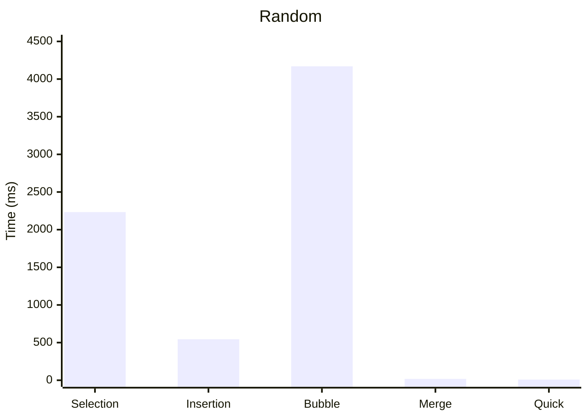
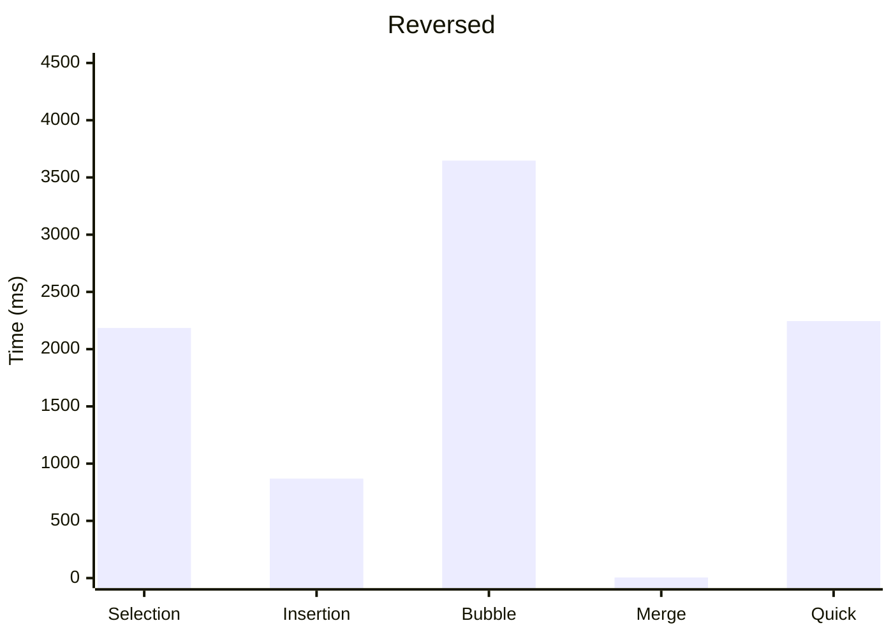
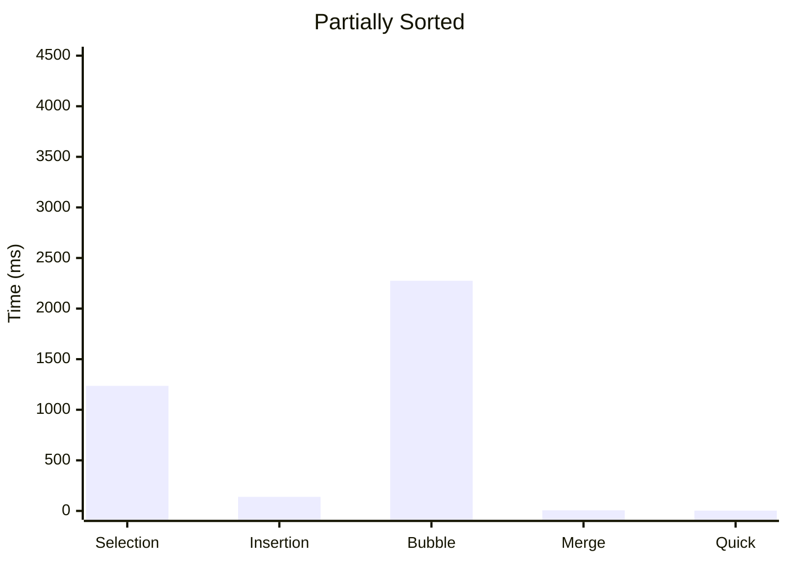
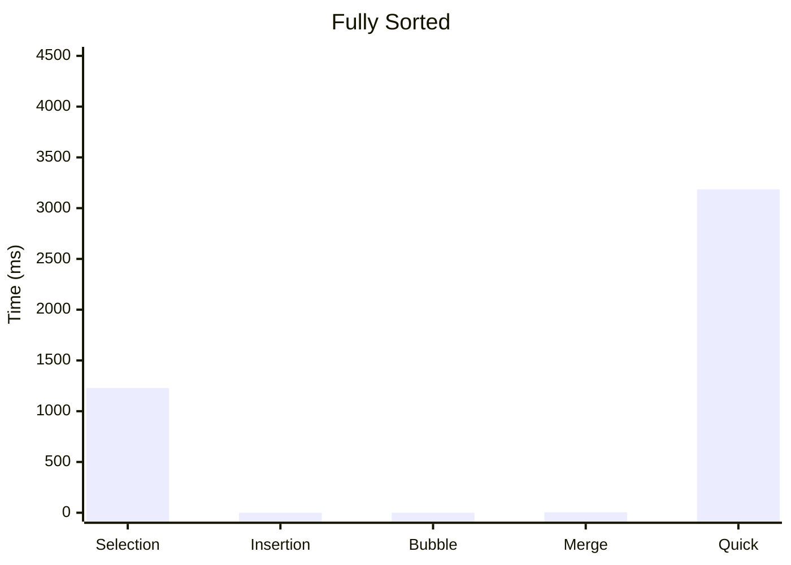

# Sorting-Algorithms-Benchmark

## 1) البيانات الشخصية

| البيان | القيمة |
|---|---|
| اسم الطالب | محمد عادل فارس |
| الرقم الجامعي | 3166091 |
| رقم الشعبة | ....B.... |
| المادة | تراكيب البيانات 2|
| النشاط | النشاط العملي: تحليل أداء خوارزميات الترتيب |
| لغة البرمجة | Java |

## 2) وصف المشروع

برنامج Java يقيس زمن تنفيذ 5 خوارزميات ترتيب على مصفوفة حجمها **N = 100,000** في 4 حالات: عشوائية، عكسية، مرتبة جزئياً (80%)، ومرتبة تماماً.
القياس بـ `System.nanoTime()` مقسوماً على 1000 (ميكروثانية)، ويشمل زمن الترتيب فقط على نسخة مستقلة لكل خوارزمية.

## 3) جدول النتائج (µs)

| الخوارزمية | عشوائية | عكسية | جزئية | مرتبة تماماً |
|---|---:|---:|---:|---:|
| Selection Sort | 2,232,873 | 2,184,922 | 1,236,485 | 1,227,583 |
| Insertion Sort | 544,621 | 868,636 | 139,032 | 87 |
| Bubble Sort | 4,168,556 | 3,647,169 | 2,274,688 | 44 |
| Merge Sort | 17,731 | 5,436 | 5,857 | 4,282 |
| Quick Sort | 9,206 | 2,245,438 | 3,493 | 3,185,451 |

## 4) الرسم البياني

مقارنة أداء الخوارزميات في كل حالة (الزمن بالميلي ثانية).

### عشوائية

### عكسية

### جزئية

### مرتبة تماماً

## 5) تحليل ومناقشة النتائج

### أ) O(n²) مقابل O(n log n)
Selection وInsertion وBubble تحتاج عدداً من العمليات يقارب n² (حوالي 10 مليار عند N = 100,000)، فتأخذ من نصف ثانية إلى 4 ثوانٍ في الحالة العشوائية.
أما Merge وQuick فتحتاج n·log n (حوالي 1.7 مليون عملية)، فتنتهي في 9 إلى 18 ميلي ثانية فقط.
في الحالة العشوائية كان Bubble أبطأ من Quick بحوالي 450 ضعفاً، وسيزداد الفرق كلما كبر N.

### ب) الأفضل في المرتبة والمرتبة جزئياً
- **المرتبة تماماً:** Bubble Sort (44 µs) وInsertion Sort (87 µs) الأفضل، لأن كلاً منهما يمرّ مرة واحدة O(n). Insertion لا يُزيح أي عنصر، وBubble لا يجد أي تبديل فيتوقف بعد دور واحد.
  أما Selection فلم يستفد من الترتيب (1.2 ثانية) لأنه يبحث عن الأصغر في كل دور.
- **المرتبة جزئياً:** Insertion Sort الأفضل بين خوارزميات O(n²) (139,032 µs)، لأن عدد الإزاحات يساوي عدد العناصر المقلوبة وهو قليل في البيانات شبه المرتبة. لكن Merge وQuick أسرع منه بكثير (حوالي 5,000 µs).

### ج) Quick Sort في الحالة العكسية والمرتبة (أثر الـ Pivot)
اخترنا الـ Pivot = آخر عنصر. في بيانات مرتبة أو عكسية يكون هذا العنصر هو الأكبر أو الأصغر دائماً،
فيقسم التقسيم المصفوفة إلى جزء فارغ وجزء بحجم n-1 بدل نصفين متوازنين.
لذلك يصير عمق الاستدعاءات n بدل log n، ويصبح الزمن O(n²).
وهذا ما ظهر في النتائج: Quick Sort أخذ 2,245,438 µs في العكسية و3,185,451 µs في المرتبة، بعد أن كان 9,206 µs في العشوائية.
الحل: اختيار Pivot عشوائي أو median-of-three، فيعود الأداء إلى O(n log n).

### د) ملاحظات
- Merge Sort أداؤه ثابت تقريباً في كل الحالات لأنه يقسم المصفوفة من المنتصف دائماً.
- الأزمنة تختلف قليلاً من جهاز لآخر، لكن الترتيب النسبي بين الخوارزميات ثابت.

## 6) طريقة التشغيل
افتح `SortingBenchmark.java` في NetBeans وشغّله، وسيطبع جدول النتائج في الـ Console (يستغرق حوالي 25 ثانية).
